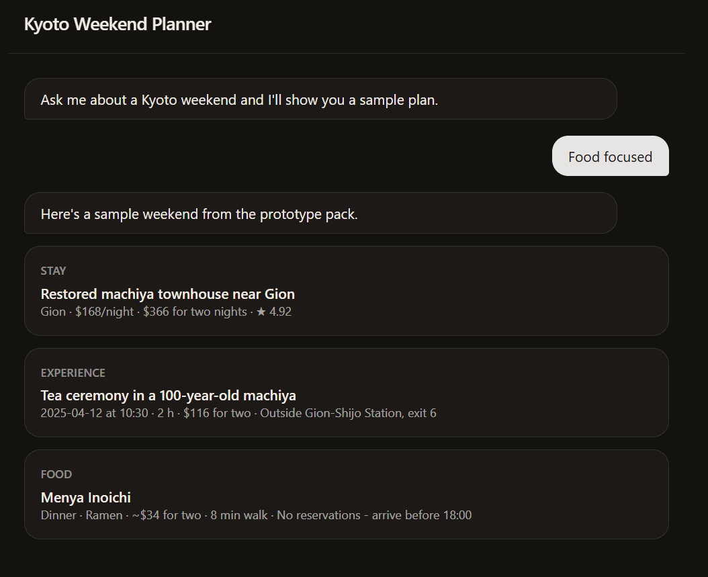
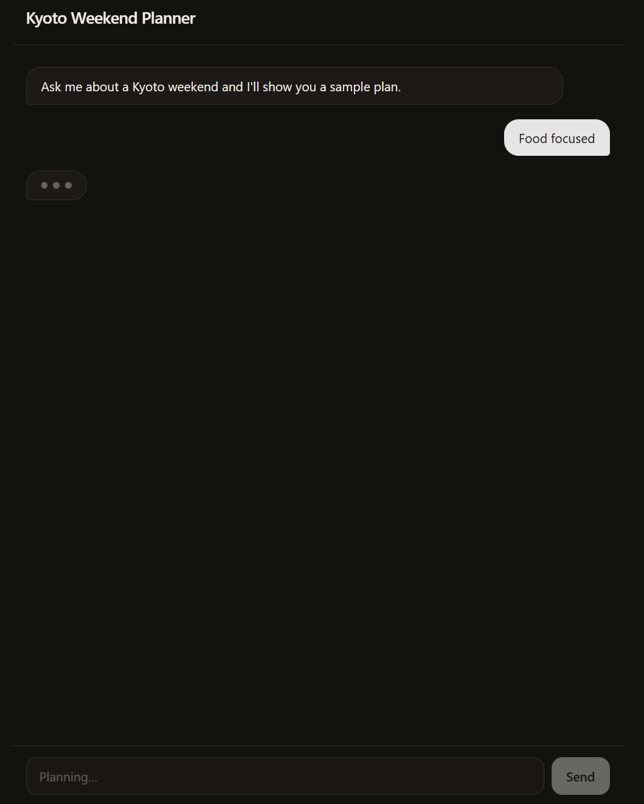

# Kyoto Weekend Planner





A Next.js (App Router) + TypeScript + Tailwind CSS chat page that builds a two-night Kyoto plan
from the prototype content pack (`Kyoto_Weekend_Prototype_Content_Pack.xlsx`).

## Run

```bash
npm install
npm run dev     # http://localhost:3000
npm run typecheck
npm run build
```

## Layout

- `lib/mock-response.ts` - one stay, one experience and one food row, typed in from the workbook.
- `components/TripChat.tsx` - chat page. Sending a message locks the input, shows a thinking
  animation for 1.5 s, then shows the three mock cards.
- `app/page.tsx` - renders the chat page.

No API keys or backend are needed.

## Known data issues

- Stay totals in the sheet don't equal nights x price (e.g. S1: 2 x $168 = $336, sheet says $366).
  The mock shows the sheet total.
- The pack is dated April 2025 and has no photo URLs (image rights not cleared).
